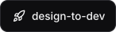

<!--
  Profil généré automatiquement : le tableau de bord (dashboard.svg) et les boutons sont
  recréés toutes les 12 h par .github/workflows/snake.yml à partir des vraies données GitHub
  (script : scripts/generate-dashboard.mjs) et publiés sur la branche `output`.
-->

  

  
  
  

  <picture>
    <source media="(prefers-color-scheme: dark)" srcset="https://raw.githubusercontent.com/duckysface/duckysface/output/github-snake-dark.svg"/>
    <source media="(prefers-color-scheme: light)" srcset="https://raw.githubusercontent.com/duckysface/duckysface/output/github-snake.svg"/>
    
  </picture>

